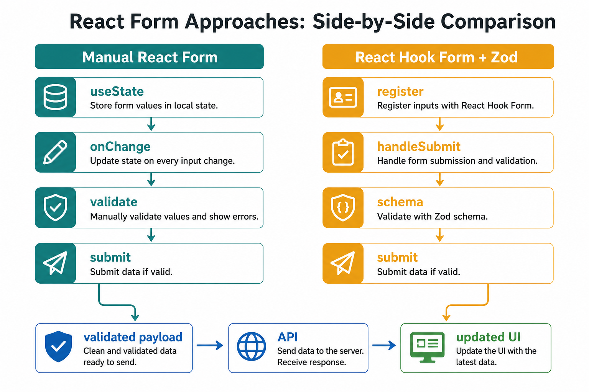

# React Learning Checkpoint: Steps 1-4

This document records what you learned while refactoring the Income and Expense Tracker. It is a refresher for future you: read the summary first, then try the challenges without looking at the answers in the code.

## Current Architecture

```txt
App
|- useTransactionSelection: which row is selected
|- useTransactions: transaction state and user actions
|  |- TransactionApi: HTTP requests with Axios
|  `- useCommon: message state
|- InputForm: add an income or expense transaction
|- MessageBanner: show success and error feedback
`- TransactionList: summary, table, selection, edit, and delete controls
   `- EditTransactionModal: edit a selected transaction
```

`App` is now a composition component. Its main job is to connect hooks to UI components instead of containing every API call, helper, and event handler itself.

## Step 1: Replace Duplicate Lists with `TransactionList`

### What You Learned

You replaced separate `Income` and `Expense` components with one reusable `TransactionList` component. Each transaction has a `type` property (`"income"` or `"expense"`), so one component can display both kinds of data.

The parent component passes data and actions down as props:

```jsx
<TransactionList
  transactionData={transactionData}
  selectedIdAndType={selectedTransactionId}
  onSelect={handleSelectedTransaction}
  openEditTransaction={openEditTransaction}
  deleteTransaction={removeTransaction}
/>
```

This is the core React data-flow pattern:

```txt
Parent state -> props -> child UI
Child user event -> callback prop -> parent or hook changes state
```

The list does not make API calls itself. It displays data, detects user interaction, and calls the functions it receives. That makes it reusable and easier to test.

### Important Concepts

- **Reusable component:** one component supports repeated UI with different data.
- **Props:** read-only values and functions passed from parent to child.
- **Single source of truth:** `transactionData` is kept in one place instead of maintaining separate, overlapping lists.
- **Stable React keys:** `getTransactionKey(id, type)` creates values such as `income:1` and `expense:1`. The type is needed because both server collections could contain an item with ID `1`.
- **Controlled selection:** the selected key lives in `useTransactionSelection`; `TransactionList` receives the current value and reports changes through `onSelect`.

### Why This Matters at Work

Duplicated components drift apart over time: one gets a bug fix, loading state, or accessibility improvement that the other does not. A well-scoped reusable component gives both transaction types the same behavior and reduces future maintenance.

### Challenge

Try these without copying existing code:

1. Add an empty state that appears when `transactionData.length === 0`.
2. Add a small transaction count to the summary.
3. Explain why using only `id` as a React `key` could be unsafe in this app.
4. Trace what happens from clicking a radio button until the selected table row receives the `selected` CSS class.

## Step 2: Add Totals and Balance with Derived Data

### What You Learned

The summary is calculated from `transactionData` with `getTransactionTotals()`:

```js
const { totalIncome, totalExpense, totalBalance } =
  getTransactionTotals(transactionData);
```

Income and expense totals are calculated with `filter()` and `reduce()`. Balance is then calculated as:

```js
totalIncome - totalExpense;
```

The formatted Indonesian amount comes from `formatAmount()`, which uses `Intl.NumberFormat("id-ID", ...)`. It converts `250000` into `250.000,00` for display.

### Important Concepts

- **Derived data:** a value calculated from state or props.
- **Do not duplicate state:** do not create `totalIncome` state with `useState` when it can always be calculated from `transactionData`.
- **Pure function:** `getTransactionTotals(transactions)` returns an answer without changing its input, React state, or the browser. Pure functions are easy to trust and test.
- **`filter()`:** keeps matching transactions, for example only income items.
- **`reduce()`:** combines an array into one value, such as a total.
- **Separation of display and data:** amounts stay as numbers for calculations; `formatAmount()` changes them only when rendering text.

### Why This Matters at Work

Duplicate state can become incorrect. For example, a transaction may be deleted but a separately stored total might not update. Derived data always follows the current transaction list, so the UI has fewer ways to get out of sync.

### Challenge

1. Add a derived `transactionCount` without adding another `useState` call.
2. Add a derived `hasNegativeBalance` boolean and use it to add a CSS class when the balance is below zero.
3. Write a small test for `getTransactionTotals()` with two incomes and one expense.
4. Explain the difference between an amount used for calculation (`250000`) and its display value (`250.000,00`).

## Step 3: Replace Browser Alerts with `MessageBanner`

### What You Learned

Instead of calling `alert()`, the app stores a message in React state through `useCommon`:

```js
showMessage("success", "Income added successfully!");
showMessage("error", "Error fetching transaction data. Please try again later.");
```

`MessageBanner` returns `null` when there is no message. When a message exists, React renders the banner and lets the user dismiss it.

```jsx
<MessageBanner message={message} onDismiss={clearMessage} />
```

### Important Concepts

- **Conditional rendering:** a component can return `null` when it should render nothing.
- **State-driven UI:** the screen is a result of current state. `message === null` means no banner; a message object means display a banner.
- **Lifting shared state:** `useTransactions` owns the message because several actions can create messages: loading, adding, editing, deleting, and validation.
- **Accessibility roles:** errors use `role="alert"` and successful messages use `role="status"`. These announce important changes to people using screen readers.
- **Callback props:** `onDismiss` lets the banner ask its owner to clear the message without knowing how message state is stored.

### Why This Matters at Work

`alert()` blocks the browser and interrupts the user. An inline message keeps the app responsive, can be styled consistently, is easier to test, and can be made accessible.

### Challenge

1. Add a different visual style for success and error messages without changing the JavaScript message shape.
2. Add an optional auto-dismiss after five seconds. Use `useEffect` and return a cleanup function that clears the timer.
3. Explain why `MessageBanner` should call `onDismiss`, rather than changing the `message` object directly.
4. Make sure a new error message replaces an old success message instead of showing two messages at once.

## Step 4: Extract API and Transaction Logic into Custom Hooks

### What You Learned

You separated responsibilities into small modules:

| Module | Responsibility |
| --- | --- |
| `api/TransactionApi.js` | Makes HTTP requests with Axios. |
| `hooks/useTransactions.js` | Stores transaction, loading, edit, delete, update, and message state; coordinates user actions. |
| `hooks/useTransactionSelection.js` | Stores and clears the selected transaction key. |
| `hooks/useCommon.js` | Stores, shows, and clears the message banner. |
| `utils/TransactionUtil.js` | Contains pure, reusable helpers such as formatting, totals, and ID validation. |
| `App.js` | Connects hook values and handlers to the component tree. |

A **custom hook** is a JavaScript function whose name starts with `use` and which calls React hooks such as `useState`, `useEffect`, or `useCallback`.

### Data Loading Flow

```txt
Component mounts
-> useEffect runs after the first render
-> loadInitialTransactions() starts
-> loadTransactions() awaits getTransactions()
-> getTransactions() fetches income and expense in parallel with Promise.all()
-> setTransactionData(data) updates state
-> React renders TransactionList with the new data
```

`Promise.all()` is useful because income and expense requests do not depend on each other. Starting both together is faster than waiting for income before starting expense.

When an add, edit, or delete request succeeds, the code uses:

```js
await loadTransactions();
```

This waits until the refreshed server data is in React state before showing the final success state, closing the edit modal, or clearing selection.

### Important Concepts

- **Async functions:** an `async` function returns a Promise. `await` pauses that function until a Promise settles; it does not freeze the whole browser.
- **`try` / `catch` / `finally`:** run a request, handle failures, and always reset loading state in `finally`.
- **`useEffect`:** synchronizes React with something outside React, here the initial API request.
- **`useCallback`:** keeps a function reference stable when another hook needs it in a dependency list. In this project, `loadTransactions` and `showMessage` are dependencies of the loading effect.
- **Hook rules:** call hooks at the top level of a component or custom hook, in the same order every render. Do not call a hook inside an `if`, loop, event handler, or regular helper function.
- **Client-only fields:** API responses gain a `type` field for the UI. Do not send UI-only fields to the server unless the server expects them.
- **React Strict Mode:** in development, it may intentionally mount, unmount, and mount components again to reveal unsafe effects. This can make initial `GET` requests appear twice. Keep Strict Mode enabled; treat effects as code that may run more than once.

### Why This Matters at Work

API code mixed into one large component becomes difficult to read, reuse, and test. This separation lets you change the server endpoint without rewriting table UI, or improve the selection behavior without touching Axios requests. It also prepares the project for tools such as TanStack Query later.

### Challenge

1. Add a `refreshTransactions` button that calls `loadTransactions()` and shows an error banner if it fails.
2. Add a loading message or disabled state during the initial request, not only during add, edit, and delete actions.
3. Explain why `useEffect` itself is not marked `async`, but it calls an inner async function.
4. Temporarily add `console.log("load")` inside the effect and compare development behavior with and without `React.StrictMode`. Restore Strict Mode afterward.
5. Move `loadTransactions` into the returned object from `useTransactions`, then use it from a button in `App`. What new UI state must you consider?

## Step 7 Plan: Learn React Router by Adding Simple Pages

### Learning Goal

Step 7 teaches routing: how a React app shows different page components when the browser URL changes.

Right now the app behaves like one screen. After this step, it should behave like a small single-page application with three routes:

| URL | Page | Purpose |
| --- | --- | --- |
| `/` | `DashboardPage` | A simple home page with a quick welcome and link to transactions. |
| `/transactions` | `TransactionsPage` | The current income and expense tracker screen. |
| `/about` | `AboutPage` | A small learning notes page for this project. |

### Core Concept

In a normal website, clicking a link often asks the server for a new HTML page. In a React single-page application, React Router lets the browser URL change while React swaps the visible component.

The beginner mental model is:

```txt
User clicks a navigation link
-> URL changes
-> React Router checks the routes
-> React renders the matching page component
```

For this project, use React Router's declarative style from `react-router-dom`:

```jsx
<Routes>
  <Route path="/" element={<DashboardPage />} />
  <Route path="/transactions" element={<TransactionsPage />} />
  <Route path="/about" element={<AboutPage />} />
</Routes>
```

The official React Router documentation shows this beginner-friendly style with `BrowserRouter`, `Routes`, and `Route`: https://reactrouter.com/start/declarative/routing

Important package note for this Create React App project:

- Install `react-router-dom`.
- Import `BrowserRouter`, `Routes`, `Route`, `Link`, and `NavLink` from `react-router-dom`.
- Do not import browser navigation components from `react-router` in React Router v6 projects.

### Why This Matters in Real React Apps

Professional React apps usually have more than one view: dashboards, lists, detail pages, settings, profiles, reports, and forms. React Router helps the app keep UI state connected to the URL.

This matters because:

- users can bookmark a page like `/transactions`
- users can refresh the browser and stay on the same page
- navigation feels like a normal website, but React still controls the UI
- each page component can stay focused on one responsibility

### Important React Router Concepts

- **`BrowserRouter`:** gives the app routing features based on the browser URL.
- **`Routes`:** the container that holds all route rules.
- **`Route`:** one rule that connects a path to a component.
- **`NavLink`:** a navigation link that knows when it is active.
- **Page component:** a normal React component used as a screen.
- **Single-page application:** the browser loads one React app, then React changes the visible page without a full reload.

### Files to Create or Modify

| File | Action | Purpose |
| --- | --- | --- |
| `client/package.json` | Modify | Add React Router DOM dependency after running the install command. |
| `client/src/index.js` | Modify | Wrap `<App />` with `<BrowserRouter>`. |
| `client/src/App.js` | Modify | Render shared layout, navigation, and route definitions. |
| `client/src/pages/DashboardPage.js` | Create | Home page for `/`. |
| `client/src/pages/TransactionsPage.js` | Create | Holds the current tracker screen. |
| `client/src/pages/AboutPage.js` | Create | Learning notes page for `/about`. |
| `client/src/App.css` | Modify | Add simple page and navigation styles. |
| `client/src/App.test.js` | Modify | Add route/navigation behavior tests. |

### Recommended Visual Direction

Keep the UI simple and familiar:

```txt
Income and Expense Tracker
Dashboard | Transactions | About

[Page content changes here]
```

The page design should stay practical:

- Dashboard: welcome text, simple summary area, and a clear button/link to transactions.
- Transactions: current form, message banner, summary, table, edit modal, and delete behavior.
- About: short notes about the React concepts learned in this project.

Do not add charts, sidebar navigation, authentication, nested routes, or dynamic route params yet. Those are good later lessons, but they would make this step too large.

### Beginner-Friendly Implementation Plan

#### Task 1: Install React Router

Run this from the `client` folder:

```bash
npm install react-router-dom@6
```

Why `react-router-dom`:

- This project uses React Router v6.
- In v6, browser-specific components such as `BrowserRouter`, `Link`, and `NavLink` are exported from `react-router-dom`.
- The lower-level `react-router` package does not export every browser navigation component used in this step.

After installing, check that `client/package.json` includes the new dependency.

#### Task 2: Wrap the App with `BrowserRouter`

Modify `client/src/index.js`.

Before:

```jsx
root.render(
  <React.StrictMode>
    <App />
  </React.StrictMode>,
);
```

After:

```jsx
import { BrowserRouter } from "react-router-dom";

root.render(
  <React.StrictMode>
    <BrowserRouter>
      <App />
    </BrowserRouter>
  </React.StrictMode>,
);
```

Why this is needed:

`BrowserRouter` is the provider for routing. Without it, components such as `Routes`, `Route`, `Link`, and `NavLink` do not know how to read or update the URL.

#### Task 3: Create the Page Files

Create this folder:

```txt
client/src/pages/
```

Create these files:

```txt
client/src/pages/DashboardPage.js
client/src/pages/TransactionsPage.js
client/src/pages/AboutPage.js
```

Start with small components:

```jsx
const DashboardPage = () => {
  return (
    <main className="page">
      <h2>Dashboard</h2>
      <p>Welcome to your income and expense tracker.</p>
    </main>
  );
};

export default DashboardPage;
```

Do the same basic pattern for `AboutPage`.

#### Task 4: Move the Current Tracker UI into `TransactionsPage`

Move the transaction-specific code from `App.js` into `TransactionsPage.js`:

- `useTransactionSelection()`
- `useTransactions(...)`
- `MessageBanner`
- `InputForm`
- `ItemHeader`
- `EditTransactionModal`
- `TransactionList`

After the move, `TransactionsPage` should feel like the old `App` body.

This is the key learning point:

```txt
App owns the routes.
TransactionsPage owns the transaction screen.
```

This keeps `App.js` smaller and gives each page one job.

#### Task 5: Add Routes in `App.js`

Import React Router pieces:

```jsx
import { NavLink, Route, Routes } from "react-router";
```

Use this import for this project:

```jsx
import { NavLink, Route, Routes } from "react-router-dom";
```

Import the pages:

```jsx
import DashboardPage from "./pages/DashboardPage";
import TransactionsPage from "./pages/TransactionsPage";
import AboutPage from "./pages/AboutPage";
```

Then make `App.js` render the shared app shell:

```jsx
function App() {
  return (
    <div className="App">
      <Header name="Income and Expense Tracker" />

      <nav className="app-nav" aria-label="Main navigation">
        <NavLink to="/">Dashboard</NavLink>
        <NavLink to="/transactions">Transactions</NavLink>
        <NavLink to="/about">About</NavLink>
      </nav>

      <Routes>
        <Route path="/" element={<DashboardPage />} />
        <Route path="/transactions" element={<TransactionsPage />} />
        <Route path="/about" element={<AboutPage />} />
      </Routes>
    </div>
  );
}
```

Why `NavLink` instead of `a`:

- `a href="/transactions"` asks the browser to load a new page.
- `<NavLink to="/transactions">` lets React Router change pages inside the React app.
- `NavLink` can also mark the current page as active.

#### Task 6: Add Simple Navigation Styles

Add styles in `client/src/App.css`:

```css
.app-nav {
  display: flex;
  justify-content: center;
  gap: 12px;
  margin: 20px auto;
  flex-wrap: wrap;
}

.app-nav a {
  padding: 8px 12px;
  color: var(--primary-color);
  text-decoration: none;
  border: 1px solid var(--border-color);
  border-radius: var(--border-radius);
  background-color: white;
}

.app-nav a.active {
  color: white;
  background-color: var(--primary-color);
  border-color: var(--primary-color);
}

.page {
  width: min(90%, 960px);
  margin: 0 auto 24px;
}
```

Keep this styling simple. Step 7 is for routing, not a full design overhaul.

#### Task 7: Add Routing Tests

Update `client/src/App.test.js` so it verifies the new routing behavior.

Example tests:

```jsx
test("renders dashboard page by default", () => {
  render(<App />);

  expect(screen.getByRole("heading", { name: /dashboard/i })).toBeInTheDocument();
});

test("navigates to the about page", async () => {
  render(<App />);

  await userEvent.click(screen.getByRole("link", { name: /about/i }));

  expect(screen.getByRole("heading", { name: /about/i })).toBeInTheDocument();
});
```

If `App` is tested without `index.js`, the test may need to wrap `App` with `BrowserRouter`:

```jsx
render(
  <BrowserRouter>
    <App />
  </BrowserRouter>,
);
```

This is normal. `index.js` wraps the real app, but tests often render components directly.

#### Task 8: Manually Test in the Browser

Run the app:

```bash
npm start
```

Then check:

1. `/` shows Dashboard.
2. `/transactions` shows the tracker.
3. `/about` shows the learning notes.
4. Clicking navigation links changes pages.
5. The page does not fully reload when clicking navigation links.
6. Add, edit, delete, totals, messages, and modal behavior still work on `/transactions`.

#### Task 9: Run Automated Verification

Run from the `client` folder:

```bash
npm test -- --watch=false
npm run build
```

Expected result:

- tests pass
- production build succeeds
- no routing import errors

#### Task 10: Commit the Step

Review changed files:

```bash
git status
```

Stage only intentional files:

```bash
git add client/package.json client/package-lock.json client/src
```

Commit:

```bash
git commit -m "feat: add basic React Router pages"
```

### Common Beginner Mistakes to Watch For

- Importing from the wrong package name. For this project, use `react-router-dom`.
- Forgetting to wrap the app with `BrowserRouter`.
- Using `<a href>` for internal app navigation instead of `Link` or `NavLink`.
- Moving transaction code into `TransactionsPage` but forgetting one import.
- Putting hooks inside `Routes` or inside conditions. Hooks still need to be called at the top level of a component.
- Expecting routes to fetch data automatically. In this step, `TransactionsPage` still uses the existing `useTransactions` hook.
- Forgetting that tests may need their own `BrowserRouter` wrapper.

### Step 7 Success Criteria

Step 7 is done when:

- `/` renders Dashboard.
- `/transactions` renders the existing tracker.
- `/about` renders learning notes.
- the navigation links work without a full page reload.
- the active navigation link is visually clear.
- existing transaction behavior still works.
- routing tests pass.
- `npm run build` succeeds.

### Challenge

1. Explain the difference between `Route` and `NavLink`.
2. Explain why `BrowserRouter` should wrap the app near the top.
3. Add a "Go to Transactions" link on the Dashboard page using `Link`.
4. Refresh the browser while on `/transactions`. What do you expect to happen?
5. Explain why `TransactionsPage` can use hooks just like `App` did before.

## Quick Refresher

| Question | Short answer |
| --- | --- |
| When should I use `useState`? | When the UI needs to remember a value between renders. |
| When should I use `useEffect`? | To synchronize with an external system, such as an API, browser timer, or event listener. |
| Should totals be state? | No. Calculate them from `transactionData`. |
| Why `await loadTransactions()`? | To wait for refreshed state before continuing the successful action flow. |
| What does `e.preventDefault()` do in a form? | Stops the browser's normal form submission and page reload so React can handle the submit. |
| Why pass callbacks as props? | A child can report an event while the parent or hook remains the owner of shared state and business logic. |

## Before You Commit

Run these commands from the repository root:

```bash
git status
cd client
npm test -- --watch=false
npm run build
cd ..
git add client
git add server/data.json
git commit -m "refactor: consolidate transaction management"
git push -u origin feature/refactor-income-expense-into-transactionlist
```

Review `git status` before staging. `server/data.json` is application data, so include it only if its changes are intentional.

## Step 8: Learn React Hook Form and Zod for Add and Edit Forms

### Goal

Replace the manual form-management code in `InputForm.js` and
`EditTransactionModal.js` with React Hook Form and Zod, while keeping the
same user-visible behavior. This is a learning exercise, so do the work in
two small checkpoints and understand the native React form first.

> The package name is **React Hook Form**, not ReactForm. It is a library for
> managing form values, submission, field state, and errors in React.

### Why forms need their own concepts

A form is more than two input boxes. A useful form usually needs to answer
these questions:

- What value is currently in each field?
- Which fields are required?
- Is the value valid?
- Has the user touched the field?
- What error should the user see?
- Is the form currently submitting?
- What should happen after a successful submit?
- How do we reset the form, especially when editing an existing record?

The current forms answer these questions manually with `useState`,
`onChange`, `e.preventDefault()`, `Number()`, `if` statements, and message
callbacks. That is a good way to learn the fundamentals, but the amount of
repeated code grows as a form gains fields and rules.

### First understand the native React pattern

Before changing code, trace `InputForm.js`:

1. `useState` stores the current name and amount.
2. `value={transactionName}` makes the input display React state.
3. `onChange` copies the browser's new value into React state.
4. `onSubmit` runs when the user submits the form.
5. `e.preventDefault()` stops a full browser page reload.
6. The component validates the values.
7. The component creates an API payload and calls `postTransaction`.
8. The component clears its local state after success.

This is called a **controlled form**: React owns the input values. It gives
you precise control, but every field needs wiring and every new validation
rule adds more component code.

### Visual mental model



The important idea is that React Hook Form does not remove the form flow. It
organizes the repetitive parts:

```text
user input -> form state -> validation -> submit handler -> API -> updated UI
```

With React Hook Form, the component still decides what to do with valid data.
With Zod, the validation rules are written as a reusable schema instead of
being scattered across event handlers.

### What each tool does

#### React Hook Form

React Hook Form provides the form-management layer:

- `useForm()` creates the form controller.
- `register("fieldName")` connects an input to the form.
- `handleSubmit(onSubmit)` runs validation before calling `onSubmit`.
- `formState.errors` contains field-level errors.
- `formState.isSubmitting` describes submission state.
- `reset(values)` replaces the current form values, which is useful for edit
  forms.

It is widely used in professional React applications and has a large
ecosystem. Its official examples use `useForm`, `register`, `handleSubmit`,
and `formState.errors`. See the [React Hook Form package documentation](https://www.npmjs.com/package/react-hook-form).

#### Zod

Zod provides the validation schema:

```js
const TransactionSchema = z.object({
  transactionName: z.string().trim().min(1, "Enter a transaction name."),
  amount: z.coerce.number().positive("Enter an amount greater than zero."),
});
```

The schema is a written agreement about acceptable data. Zod can parse the
submitted object and return either validated data or structured errors. It
works in plain JavaScript as well as TypeScript, so it is suitable for this
learning step. See the [Zod documentation](https://zod.dev/).

#### The resolver bridge

React Hook Form and Zod have separate jobs. The `@hookform/resolvers` package
connects them:

```bash
cd client
npm install react-hook-form zod @hookform/resolvers
```

The connection concept is:

```js
useForm({
  resolver: zodResolver(TransactionSchema),
});
```

Do not memorize this line yet. Understand the division of responsibility:
React Hook Form manages the form; Zod describes valid data; the resolver
translates Zod results into React Hook Form errors.

### Detailed file-by-file implementation map

Keep responsibilities separate while you migrate:

| File | Responsibility after Step 8 |
| --- | --- |
| `src/validation/TransactionSchema.js` | Defines reusable name and amount rules |
| `src/components/InputForm.js` | Renders fields and submits a new transaction |
| `src/components/EditTransactionModal.js` | Renders fields for the selected transaction and saves changes |
| `src/hooks/useTransactions.js` | Performs API calls, refreshes data, and owns request messages |
| `src/components/*test.js` | Verifies what a user can see and do |

The form components should not call Axios directly. They should send a clean
payload to the existing hook callback, just as they do today.

### Step 8A implementation shape

First create the schema. This is a plain JavaScript module, not a React
component:

```js
import { z } from "zod";

export const TransactionSchema = z.object({
  transactionName: z.string().trim().min(1, "Enter a transaction name."),
  amount: z.coerce.number().positive("Enter an amount greater than zero."),
});
```

Why `z.coerce.number()`? Browser inputs normally provide text values, even
when `type="number"` is used. Coercion converts a value such as `"250000"`
into the number `250000` before the positive-number rule runs. Confirm this
behavior with a small test rather than assuming it.

Then create the form controller inside `InputForm`:

```js
const {
  register,
  handleSubmit,
  reset,
  formState: { errors, isSubmitting },
} = useForm({
  resolver: zodResolver(TransactionSchema),
  defaultValues: {
    transactionName: "",
    amount: "",
  },
});
```

The input then becomes conceptually smaller:

```jsx
<input
  id="transaction-name"
  {...register("transactionName")}
  aria-invalid={Boolean(errors.transactionName)}
/>
{errors.transactionName && (
  <p role="alert">{errors.transactionName.message}</p>
)}
```

The submit handler receives validated form data. It does not receive the
browser event because `handleSubmit` has already handled the submit event and
prevented the normal page reload:

```js
const handleAddTransaction = async (values, event) => {
  const type = event?.nativeEvent?.submitter?.value || "income";

  await postTransaction(type, values);
  reset();
};
```

There is one project-specific detail: the current `postTransaction` function
handles errors inside `useTransactions` and does not rethrow them. Therefore,
`await postTransaction(...)` waits for the hook's work, but it cannot tell the
form whether the request succeeded. For the first migration, preserve the
existing behavior and compare it carefully. If you want to reset only after a
successful request, make the hook return an explicit result such as
`{ success: true }` or `{ success: false }`, then reset only when
`result.success` is true. This is a useful async API-contract exercise.

The two income/expense buttons should remain submit buttons with different
values. Do not turn them into ordinary click handlers that bypass the form's
single submit path. The form still owns validation; the button only supplies
the transaction type.

### Step 8B implementation shape

The edit modal needs the same schema and controller, but it also receives
`transaction` from its parent. Start with safe empty defaults:

```js
const form = useForm({
  resolver: zodResolver(TransactionSchema),
  defaultValues: {
    transactionName: "",
    amount: "",
  },
});
```

When the selected transaction changes, synchronize the form values:

```js
const { reset } = form;

useEffect(() => {
  if (transaction) {
    reset({
      transactionName: transaction.transactionName || "",
      amount: transaction.amount || "",
    });
  }
}, [transaction, reset]);
```

The important distinction is:

```text
transaction prop = source record selected by the parent
form values       = temporary edits inside the modal
reset(...)        = synchronize temporary edits with a new source record
```

Do not use `setValue` for every field unless you have a specific reason. For
a complete record replacement, `reset` communicates the intent more clearly.
Keep the existing focus `useEffect` separate from the value-synchronization
effect so each effect has one job.

### Submission and API payload boundary

The form library should produce this data shape:

```js
{
  transactionName: "Salary",
  amount: 5000,
}
```

`InputForm` adds the type when calling `postTransaction(type, values)`.
`EditTransactionModal` passes the existing `id` and `type` to `onSave`, then
passes the same two-field payload. The API hook remains the place that knows
how to call the server. This keeps the form concerned with user input and the
hook concerned with server state.

### Error rendering and accessibility details

For each field, give the error a stable id and connect it to the input:

```jsx
<input
  aria-invalid={Boolean(errors.amount)}
  aria-describedby={errors.amount ? "amount-error" : undefined}
  {...register("amount")}
/>
{errors.amount && (
  <p id="amount-error" role="alert">
    {errors.amount.message}
  </p>
)}
```

The exact markup can follow the existing CSS, but the user should be able to
identify which field failed without relying only on color. Do not replace the
existing visible labels with placeholders.

### Common migration traps

- Registering an input but leaving its old `value` prop can create two owners
  for the same value. Choose one form-management approach for each field.
- Forgetting to spread `{...register("fieldName")}` means the field is not
  connected to React Hook Form.
- Calling `handleAddTransaction()` directly from a button bypasses the normal
  validation flow. Submit the `<form>` instead.
- Treating `defaultValues` as reactive values causes stale edit fields. Use
  `reset` when the selected transaction changes.
- Resetting before the API finishes can erase useful input during a failure.
- Assuming `type="number"` guarantees a JavaScript number. Inspect the actual
  submitted value and let the schema or an explicit conversion define the
  payload type.
- Moving API logic into the form makes the component harder to reuse. Keep
  `postTransaction` and `editTransaction` in `useTransactions`.

### Industry-standard judgment

React Hook Form plus Zod is an industry-standard combination, but it is not
the only professional choice. Teams also use native validation, Formik,
TanStack Form, Vest, Yup, Valibot, or custom solutions depending on the
application. The professional skill is knowing why a tool is appropriate.

For this project, the combination is useful because the forms are becoming a
realistic boundary between user input and an API. It also prepares you for
Step 10, where TypeScript can infer types from schemas.

Do not use a form library automatically for every tiny form. A search box or a
single boolean toggle may be clearer with ordinary React and HTML. A larger
form with repeated fields, validation, async submission, or edit/reset
behavior is where the library starts to earn its cost.

### Pros and cons

| Benefit | Trade-off |
| --- | --- |
| Less repetitive `useState` and `onChange` code | You must learn a library API |
| Consistent field-level errors | Errors are accessed through an abstraction |
| Easier touched, dirty, and submitting state | A small form may become more complex |
| Reusable Zod schemas | Adds dependencies and bundle code |
| Easier future TypeScript integration | Schema rules still need thoughtful design |
| Good support for larger forms | The server must still validate independently |

Client validation improves feedback; it is not a security boundary. The
Express server must continue validating incoming data because a client can be
modified or bypassed.

## Checkpoint 8A: Migrate `InputForm` First

Do this checkpoint manually and keep the edit modal unchanged.

### Suggested sequence

1. Install `react-hook-form`, `zod`, and `@hookform/resolvers`.
2. Create a small transaction schema in a focused file such as
   `src/validation/TransactionSchema.js`.
3. Import `useForm` into `InputForm.js`.
4. Replace the two `useState` values with `useForm` values.
5. Add `register` to the name and amount inputs.
6. Replace `onSubmit={handleAddTransaction}` with
   `onSubmit={handleSubmit(handleAddTransaction)}`.
7. Display each field's error next to its input.
8. Preserve the existing income/expense button behavior.
9. Keep the API payload shape unchanged:
   `{ transactionName, amount }`.
10. Reset the form only after the API action succeeds.

### Beginner questions to answer while coding

- What did `register` replace compared with the old `value` and `onChange`?
- Why does `handleSubmit` receive your function instead of replacing it?
- Where does the number conversion happen?
- What does the user see when the name is empty?
- What happens if the API request fails? Is the form cleared?
- Why is the transaction type still application behavior rather than part of
  the shared name/amount schema?

### Pause and verify

After Checkpoint 8A, manually verify:

- Empty name shows a useful message.
- Empty amount shows a useful message.
- Zero and negative amounts are rejected.
- Decimal amounts are handled correctly.
- Add Income still creates an income transaction.
- Add Expense still creates an expense transaction.
- A failed request does not silently erase the user's input.
- The list and totals still refresh after a successful request.

## Checkpoint 8B: Migrate `EditTransactionModal`

Only start this checkpoint after 8A is understandable and working.

The edit modal introduces an important new concept: **external values can
change while the component is mounted**. When the selected transaction
changes, the form must display the new transaction. React Hook Form's
`reset(transactionValues)` is designed for this job.

### 8B.1 Replace the imports and local state

Remove the field-specific `useState` calls. Keep `useEffect` for `reset` and
the Escape-key listener. The current beginner implementation uses `autoFocus`
for the name field, so it does not need `useRef` or `setFocus`.

```js
import { useEffect } from "react";
import { useForm } from "react-hook-form";
import { zodResolver } from "@hookform/resolvers/zod";
import { TransactionSchema } from "../validation/TransactionSchema";
```

The component props remain the same:

```js
const EditTransactionModal = ({
  transaction,
  updating,
  onCancel,
  onSave,
  onMessage = () => {},
}) => {
```

`transaction` is the record selected by the parent. The form values are only
the temporary edits made inside the modal.

### 8B.2 Create the form controller

Create the controller near the top of the component:

```js
const {
  register,
  handleSubmit,
  reset,
  formState: { errors, isSubmitting },
} = useForm({
  resolver: zodResolver(TransactionSchema),
  defaultValues: {
    transactionName: "",
    amount: "",
  },
});
```

`defaultValues` are used when the form is first created. They do not
automatically update when the `transaction` prop changes. That is why the
next effect is necessary.

### 8B.3 Synchronize the selected transaction with `reset`

Replace the old effect that calls `setTransactionName` and `setAmount` with:

```js
useEffect(() => {
  if (!transaction) {
    return;
  }

  reset({
    transactionName: transaction.transactionName || "",
    amount: transaction.amount ?? "",
  });
}, [transaction, reset]);
```

The `??` operator is useful for `amount`: it only falls back when the value
is `null` or `undefined`. It does not replace a valid zero with an empty
string. The schema will reject zero later because the amount must be
positive.

The data ownership now looks like this:

```text
transaction prop = source record selected by the parent
form values       = temporary edits inside the modal
reset(...)        = synchronize temporary edits with a new source record
```

Do not use `setValue` for every field unless you have a specific reason. For
a complete record replacement, `reset` communicates the intent more clearly.

### 8B.4 Preserve focus and Escape-to-close behavior

For this beginner implementation, use the browser's `autoFocus` attribute on
the transaction name input. React Hook Form can still register the field
normally, so no extra `ref` or `setFocus` call is needed.

```jsx
<input
  id="edit-transaction-name"
  type="text"
  autoFocus
  {...register("transactionName")}
/>
```

Keep Escape handling in its own effect:

```js
useEffect(() => {
  if (!transaction) {
    return;
  }

  const handleEscapeKey = (event) => {
    if (event.key === "Escape" && updating === null) {
      onCancel();
    }
  };

  document.addEventListener("keydown", handleEscapeKey);

  return () => {
    document.removeEventListener("keydown", handleEscapeKey);
  };
}, [transaction, updating, onCancel]);
```

Keep this effect separate from the `reset` effect. The effects have different
jobs:

- the first effect synchronizes form values;
- the second effect manages the global Escape listener.

`autoFocus` places the cursor in the name field when the modal opens. It is a
good learning-friendly choice. A later accessibility upgrade can restore focus
to the Edit button after the modal closes; that requires storing the previously
focused element with a ref.

### 8B.5 Add the submit handler

The submit handler receives validated values from React Hook Form. It should
not call `preventDefault` or perform manual `Number()` conversion.

```js
const handleSaveTransaction = async (values) => {
  await onSave(transaction.id, transaction.type, values);
};
```

The existing `editTransaction` hook already owns the API request. The modal
only supplies the selected record identity and the validated two-field
payload.

### 8B.6 Connect the modal form

Keep the early return so the modal is not rendered without a selected record:

```js
if (!transaction) {
  return null;
}

const isSaving = updating === transaction.id;
const isBusy = isSaving || isSubmitting;
```

Connect the form to `handleSubmit`:

```jsx
<form onSubmit={handleSubmit(handleSaveTransaction)}>
```

Register the name field:

```jsx
<label htmlFor="edit-transaction-name">Transaction Name</label>
<input
  id="edit-transaction-name"
  type="text"
  {...register("transactionName")}
  aria-invalid={Boolean(errors.transactionName)}
  aria-describedby={
    errors.transactionName ? "edit-transaction-name-error" : undefined
  }
  disabled={isBusy}
/>
{errors.transactionName && (
  <p id="edit-transaction-name-error" role="alert">
    {errors.transactionName.message}
  </p>
)}
```

Register the amount field in the same way:

```jsx
<label htmlFor="edit-transaction-amount">Transaction Amount</label>
<input
  id="edit-transaction-amount"
  type="number"
  inputMode="decimal"
  {...register("amount")}
  aria-invalid={Boolean(errors.amount)}
  aria-describedby={
    errors.amount ? "edit-transaction-amount-error" : undefined
  }
  disabled={isBusy}
/>
{errors.amount && (
  <p id="edit-transaction-amount-error" role="alert">
    {errors.amount.message}
  </p>
)}
```

Use `isBusy` for both buttons:

```jsx
<button type="submit" disabled={isBusy}>
  {isBusy ? "Updating..." : "Save"}
</button>

<button type="button" onClick={onCancel} disabled={isBusy}>
  Cancel
</button>
```

### 8B.7 Complete data flow

After the migration, the edit flow should be:

```text
user selects transaction
        |
parent passes transaction prop
        |
reset(...) fills the modal form
        |
user changes temporary form values
        |
handleSubmit validates with Zod
        |
handleSaveTransaction calls onSave(id, type, values)
        |
useTransactions sends the PUT request
        |
parent refreshes data and closes the modal on success
```

If validation fails, `onSave` is not called. If the API update fails, the
modal should remain available and the user's unsaved values should remain in
the form.

### 8B.8 Common migration mistakes

- Leaving `value` and `onChange` on an input after adding `register` creates
  two competing owners for the field.
- Adding a second `ref` to a registered input makes the code harder to follow.
  This project uses `autoFocus` for now; introduce a ref later only when you
  add return-focus behavior.
- Calling `reset` on every render erases the user's edits. Call it only when
  the selected `transaction` changes.
- Using `defaultValues` alone produces stale values when the user selects a
  different transaction.
- Calling `onSave` directly from the button bypasses Zod validation. Submit
  the form through `handleSubmit`.
- Resetting the form after a failed update loses the user's unsaved changes.
- Reusing the add-form handler is incorrect because the edit flow must include
  `transaction.id` and `transaction.type`.

### Accessibility checks

Keep the work from Step 6 intact:

- every input still has a visible label;
- the dialog keeps `role="dialog"`, `aria-modal`, and its label;
- `autoFocus` places focus in the name field when the modal opens;
- Escape closes it when saving is not in progress;
- error text is understandable and associated with the relevant field.

## Testing Practice for Step 8

Test user behavior rather than implementation details:

- submit the add form with invalid data and assert visible errors;
- submit valid income data and assert the callback payload;
- submit valid expense data and assert the selected type;
- open the edit modal with one transaction, then rerender with another and
  assert that the fields show the new transaction;
- verify that a failed submission keeps the form values;
- verify that the submit button communicates the submitting state.

These tests should use Testing Library and `userEvent`, because they model
how a person interacts with the form. Avoid testing private React Hook Form
internals such as its internal registry.

## Step 8 Completion Checklist

- [x] I can explain the original controlled-form implementation.
- [x] I can explain the jobs of React Hook Form, Zod, and the resolver.
- [x] `InputForm` uses React Hook Form and Zod.
- [x] `EditTransactionModal` uses React Hook Form and Zod.
- [x] Add and edit API payloads have not changed unexpectedly.
- [x] Validation errors are visible and accessible.
- [x] Edit values update correctly when the selected transaction changes.
- [x] Existing accessibility behavior still works.
- [x] Focused component tests pass.
- [ ] `npm run build` succeeds.

## Step 8 Learning Summary

You completed the migration from manual controlled inputs to React Hook Form
and Zod for both adding and editing transactions.

### What you learned

- **Controlled forms:** the previous approach stored each input in `useState`
  and updated it with `value` and `onChange`.
- **React Hook Form:** `useForm` creates a form controller, `register` connects
  an input, and `handleSubmit` validates before calling the submit function.
- **Zod:** `TransactionSchema` is the reusable definition of a valid
  transaction name and amount.
- **Resolver:** `zodResolver(TransactionSchema)` translates Zod validation
  results into `errors`, which the components render beside their fields.
- **Data conversion:** `z.coerce.number()` converts the amount from browser
  input text into a JavaScript number after successful validation.
- **Edit form synchronization:** `reset` replaces the edit form values when a
  different transaction is selected, without making every field its own state
  variable.
- **Submission state:** `isSubmitting` and `updating` prevent duplicate edits
  while a save request is in progress.
- **Accessible errors:** `aria-invalid`, `aria-describedby`, and `role="alert"`
  connect validation messages to the relevant input and announce new errors to
  assistive technology.
- **Simple modal focus:** `autoFocus` moves focus into the modal when it opens.
  Returning focus to the triggering button is a useful future accessibility
  exercise.

### Challenge questions

1. Why should an input use either `value`/`onChange` or `register`, rather than
   both at once?
2. Why does the edit modal call `reset` when `transaction` changes?
3. Why is client-side Zod validation helpful but insufficient as server-side
   security validation?
4. What is the difference between `isSubmitting` and your application's
   `updating` state?
5. How would you restore focus to the Edit button after the modal closes?

## Step 10: Gradually Migrate to TypeScript

### Goal

Add TypeScript to the client one small area at a time. The goal is not to
rewrite the app or make every file perfect immediately. The goal is to let the
TypeScript compiler catch incorrect transaction data, missing props, and API
mistakes before they reach the browser.

Do this step before TanStack Query. Once the transaction model has reliable
types, Step 9 can use those same types for query results and mutation payloads.

### TypeScript fundamentals for a React beginner

JavaScript is dynamically typed: a variable can hold any value, and many
mistakes are discovered only while the app runs.

```js
const amount = "250000";
amount.toFixed(2); // The mistake is found only at runtime.
```

TypeScript adds a compile-time checker on top of JavaScript:

```ts
const amount: number = 250000;
amount.toFixed(2); // TypeScript knows this is valid.
```

Type annotations are removed when the app is built. The browser still runs
JavaScript, so TypeScript does not validate data arriving from an API at
runtime. Keep Zod: Zod validates real values at runtime, while TypeScript
helps you write correct code before runtime.

```text
Zod:        Is this actual user/API data valid right now?
TypeScript: Does this code use data consistently while we develop?
```

### The small set of type concepts to learn first

| Concept | Example | Why it matters here |
| --- | --- | --- |
| Primitive type | `amount: number` | Prevents treating money as text by accident. |
| Object type | `type Transaction = { ... }` | Gives one name to the shape shared by the app. |
| Union type | `"income" \| "expense"` | Prevents invalid categories such as `"salary"`. |
| Optional property | `id?: number` | Represents a new record before the server creates its ID. |
| `null` | `Transaction \| null` | Models an optional selected transaction honestly. |
| Function type | `(transaction: Transaction) => void` | Documents what a callback receives. |
| Generics | `useState<Transaction[]>([])` | Tells React what belongs in state. |

Use `type` for the simple data models in this project. `interface` is also
valid TypeScript; the important beginner skill is describing data accurately,
not choosing between two similar keywords.

### What TypeScript will and will not solve

TypeScript will help catch:

- passing a string amount where a number is expected;
- calling `deleteTransaction` with the wrong argument order;
- forgetting a required callback prop;
- accessing a property that a transaction does not have;
- returning an incomplete API payload.

TypeScript will not:

- prove that the backend returned trustworthy data;
- replace Zod validation of form input;
- prevent a network request from failing;
- fix UI behavior by itself.

### Migration rules

1. Rename one related group of files at a time: `.js` to `.ts` for non-JSX
   files and `.js` to `.tsx` for files that render JSX.
2. Run tests, lint, and build after each checkpoint.
3. Do not add `any` just to silence TypeScript. Prefer a real type, `unknown`,
   or a small runtime check.
4. Do not change behavior while converting a file. A TypeScript checkpoint is
   easier to review when it contains types, not an unrelated refactor.
5. Keep Zod schemas in place. They protect runtime form/API data; TypeScript
   describes the data used by source files.

### Step 10 implementation plan

Create a feature branch before starting:

```bash
git switch -c feature/step-10-typescript-foundation
```

#### Checkpoint 10.0: Set up TypeScript without converting app code

**Files:** `client/package.json`, `client/package-lock.json`, and the new
`client/tsconfig.json` generated by Create React App.

1. Confirm the client is clean enough to isolate the checkpoint:

   ```bash
   cd client
   npm test -- --watchAll=false --runInBand
   npm run lint
   ```

2. This application uses Create React App 5, whose TypeScript peer dependency
   supports TypeScript 4 rather than the newest TypeScript release. Install
   these compatible versions. Do not use `--force` or `--legacy-peer-deps`;
   resolve a version conflict before continuing.

   ```bash
   npm install --save-dev typescript@4.9.5 @types/react@18.3.3 @types/react-dom@18.3.0 @types/node@18.19.45
   npm install zod@3.23.8
   ```

   Why pin Zod 3? This project uses `react-scripts@5.0.1`, which works with
   TypeScript 4. Zod 4's published types require newer TypeScript syntax, so
   Zod 3 keeps the existing form validation behavior while allowing the
   TypeScript compiler to run. This is a compatibility decision for this older
   build tool, not a statement that Zod 4 is bad. A future migration from
   Create React App to Vite can safely revisit newer TypeScript and Zod versions.

3. Rename one harmless entry file, such as `src/reportWebVitals.js`, to
   `src/reportWebVitals.ts`. Create React App will generate a starter
   `tsconfig.json` when it detects TypeScript.
4. Update the `lint` script so ESLint includes the new extensions:

   ```json
   "lint": "eslint src --ext .js,.jsx,.ts,.tsx"
   ```

5. Run `npm start` and confirm the app compiles. Commit this setup separately:

   ```bash
   git add client/package.json client/package-lock.json client/tsconfig.json client/src/reportWebVitals.ts
   git commit -m "chore: add TypeScript support"
   ```

**Why this checkpoint exists:** setup problems are separated from data-model
problems, so the first error list stays small and understandable.

#### Checkpoint 10A: Define the transaction domain model

**Create:** `client/src/types/transaction.ts`

The current API stores an ID, name, and amount. The client adds `type` after
loading income and expense records. Represent those two shapes explicitly:

```ts
export type TransactionType = "income" | "expense";

export type TransactionPayload = {
  transactionName: string;
  amount: number;
};

export type Transaction = TransactionPayload & {
  id: number;
  type: TransactionType;
};

export type TransactionTotals = {
  totalIncome: number;
  totalExpense: number;
  totalBalance: number;
};
```

Then create `client/src/types/transaction.test.ts` only if you add runtime
helpers there. Pure TypeScript types disappear at build time and do not need
unit tests by themselves. Their protection is the compiler.

**Learning challenge:** explain why `TransactionPayload` does not include
`id` or `type`: a new form submits editable server data, while the client adds
identity and category when it reads a saved transaction.

Commit this model separately:

```bash
git add client/src/types/transaction.ts
git commit -m "feat: define transaction TypeScript types"
```

#### Checkpoint 10B: Convert pure utilities first

**Rename:** `src/utils/TransactionUtil.js` to `src/utils/TransactionUtil.ts`

**Update:** `src/utils/TransactionUtil.test.js` to import the renamed module.

Import the domain types and add function signatures:

```ts
import type {
  Transaction,
  TransactionTotals,
  TransactionType,
} from "../types/transaction";

const getTransactionKey = (id: number, type: TransactionType): string =>
  `${type}:${id}`;

const getTransactionTotals = (
  transactions: Transaction[],
): TransactionTotals => {
  // Keep the existing one-pass calculation unchanged.
};
```

Use this checkpoint to understand that a parameter type documents what a
function accepts, and a return type documents what callers can rely on.

Run:

```bash
npm test -- --watchAll=false --runInBand src/utils/TransactionUtil.test.js
npm run lint
```

#### Checkpoint 10C: Convert the API module

**Rename:** `src/api/TransactionApi.js` to `src/api/TransactionApi.ts`

**Update:** `src/api/TransactionApi.test.js` imports.

Use `TransactionType`, `TransactionPayload`, and `Transaction` in the API
function signatures:

```ts
const createTransaction = (
  type: TransactionType,
  payload: TransactionPayload,
) => axios.post<TransactionPayload>(`${URL}/${type}`, payload);

const updateTransaction = (
  type: TransactionType,
  id: number,
  payload: TransactionPayload,
) => axios.put<TransactionPayload>(`${URL}/${type}/${id}`, payload);
```

For `getTransactions`, type the response data as server payloads before adding
the client-only `type` property. Do not use `as Transaction[]` as a shortcut;
map the response into the `Transaction` shape deliberately.

Run the API tests, then the full suite. Commit this checkpoint independently.

#### Checkpoint 10D: Convert the transaction hook

**Rename:** `src/hooks/useTransactions.js` to `src/hooks/useTransactions.ts`

Type the state first:

```ts
const [transactionData, setTransactionData] = useState<Transaction[]>([]);
const [editingTransaction, setEditingTransaction] =
  useState<Transaction | null>(null);
const [deleting, setDeleting] = useState<number | null>(null);
const [updating, setUpdating] = useState<number | null>(null);
```

Then type function inputs and outcomes. For example, return the same explicit
success result that Step 8 forms already use:

```ts
type MutationResult = { success: true } | { success: false };
```

Keep the current API behavior and existing tests. The hook conversion should
not introduce TanStack Query yet; that is the next learning step.

#### Checkpoint 10E: Convert component props from leaves upward

Convert small presentational components before `App`:

1. `MessageBanner.js` to `MessageBanner.tsx`
2. `ItemHeader.js` to `ItemHeader.tsx`
3. `TransactionList.js` to `TransactionList.tsx`
4. `InputForm.js` and `EditTransactionModal.js` to `.tsx`
5. Page components, then `App.js` to `App.tsx`
6. `index.js` to `index.tsx`

For a component callback, make the contract visible near the component:

```ts
type TransactionListProps = {
  transactionData: Transaction[];
  selectedIdAndType: string | null;
  onSelect: (id: number, type: TransactionType) => void;
  openEditTransaction: (transaction: Transaction) => void;
  deleteTransaction: (transaction: Transaction) => Promise<void>;
  deleting: number | null;
  updating: number | null;
};
```

Do not convert all components in one commit. After every one or two related
files, run the component tests that cover them and commit a focused change.

#### Checkpoint 10F: Tighten safely and prepare for Step 9

Once all client files are TypeScript:

1. Enable `noImplicitAny` in `tsconfig.json` if Create React App did not
   already set it.
2. Search for `any` and replace each occurrence with a real type or `unknown`.
3. Run the full suite, lint, and production build:

   ```bash
   npm test -- --watchAll=false --runInBand
   npm run lint
   npm run build
   ```

4. Confirm that the shared `Transaction`, `TransactionPayload`, and
   `TransactionType` types are ready to be reused by TanStack Query in Step 9.

### Step 10 completion checklist

- [x] TypeScript compiler, React type packages, and `tsconfig.json` are in
  place without forced dependency installation.
- [x] A shared transaction type module describes saved records and API payloads.
- [x] Utility and API modules are TypeScript files with typed inputs/outputs.
- [x] `useTransactions` state and mutation results are typed.
- [x] Component props are typed without broad `any` values.
- [ ] Zod remains responsible for runtime validation.
- [x] Zod remains responsible for runtime validation.
- [ ] Full tests, lint, and production build pass. Run these locally when the
  Create React App runners are responsive: `npm test -- --watchAll=false --runInBand`,
  `npm run lint`, and `npm run build`.
- [ ] Each checkpoint has a small, focused commit.

## Next Learning Roadmap

You have completed Steps 1-8. Continue in this revised order:

10. Gradually migrate to TypeScript.
9. Learn TanStack Query for server/API state using the new transaction types.

The goal is not to use every library quickly. Build the mental model first:
components render UI, state drives that UI, props move data down, callbacks
send events up, hooks organize stateful behavior, and form libraries manage
repetitive form concerns without hiding the underlying browser flow.
