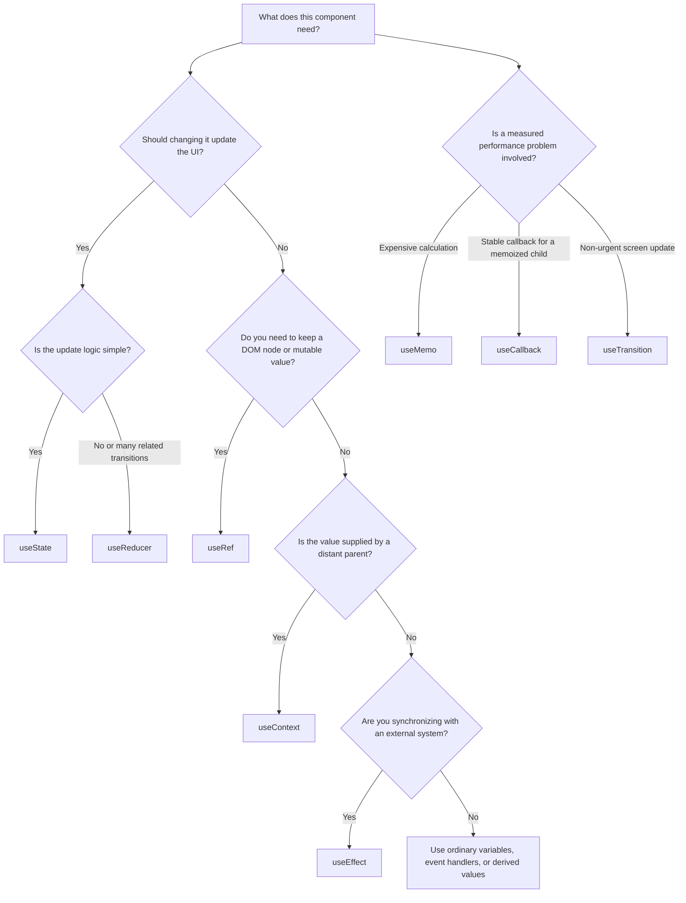

# React Hooks: a Practical Beginner's Tutorial

React Hooks let function components use React features such as state, context, refs, effects, and rendering priorities. This guide focuses on the Hooks you will encounter most often in production React applications, using a small expense-tracker as the running example.

> This tutorial is based on the [official React Hooks reference](https://react.dev/reference/react/hooks). It teaches when to reach for a Hook; the linked reference is the source of truth for detailed API behavior.

## 1. The two Rules of Hooks

Before choosing a Hook, remember these rules:

1. Call Hooks only at the top level of a React function component or custom Hook—never inside loops, conditions, event handlers, or nested functions.
2. Call Hooks only from React function components or custom Hooks.

```tsx
// Good: always called in the same order during every render.
function ExpenseList() {
  const [expenses, setExpenses] = useState<Expense[]>([]);
  // ...
}

// Bad: Hook is inside a condition.
if (isLoggedIn) {
  const [expenses, setExpenses] = useState<Expense[]>([]);
}
```

## 2. Quick decision map



## 3. `useState`: remember UI data

`useState` stores information that affects what the component renders. Calling its setter schedules a re-render.

**Use it when:** the screen must change after a user action, response, or local interaction—form fields, open/closed UI, selected tabs, fetched data, errors, and simple counters.

```tsx
type Expense = { id: string; title: string; amount: number };

function AddExpense() {
  const [title, setTitle] = useState('');
  const [expenses, setExpenses] = useState<Expense[]>([]);

  function addExpense() {
    const expense = { id: crypto.randomUUID(), title, amount: 0 };
    setExpenses(previous => [...previous, expense]);
    setTitle('');
  }

  return <button onClick={addExpense}>Add {title || 'expense'}</button>;
}
```

**Watch out for:** when the new value depends on the old value, use the updater form (`previous => ...`). Do not mutate arrays or objects in state; create a new one.

## 4. `useEffect`: synchronize with the outside world

An Effect runs after React has updated the screen. Its job is to connect a component to something outside React: a network connection, browser API, timer, DOM widget, or analytics subscription.

**Use it when:** you must start and clean up an external process as props or state change.

```tsx
function ExchangeRate({ currency }: { currency: string }) {
  const [rate, setRate] = useState<number | null>(null);

  useEffect(() => {
    let cancelled = false;

    fetch(`/api/rates?currency=${encodeURIComponent(currency)}`)
      .then(response => response.json())
      .then(data => {
        if (!cancelled) setRate(data.rate);
      });

    return () => {
      cancelled = true;
    };
  }, [currency]);

  return <span>{rate ?? 'Loading…'}</span>;
}
```

**Watch out for:** do not use an Effect merely to calculate a value from existing props/state. Calculate it during rendering instead:

```tsx
// Good: no extra state and no Effect needed.
const total = expenses.reduce((sum, expense) => sum + expense.amount, 0);
```

An Effect may return a cleanup function. Use it to unsubscribe, disconnect, or cancel work. Include every reactive value read by the Effect in its dependency array; let the Hooks linter help you enforce this.

## 5. `useContext`: receive shared values without prop drilling

Context allows a distant parent to provide a value to descendants without passing it through every component in between.

**Use it when:** a broadly shared, relatively stable value is needed across a subtree: current theme, authenticated user, locale, or a feature flag.

```tsx
const CurrencyContext = createContext('USD');

function Amount({ value }: { value: number }) {
  const currency = useContext(CurrencyContext);
  return <span>{new Intl.NumberFormat(undefined, { style: 'currency', currency }).format(value)}</span>;
}

function App() {
  return (
    <CurrencyContext value="IDR">
      <Amount value={125000} />
    </CurrencyContext>
  );
}
```

**Watch out for:** a context value changing makes all consumers using that context update. Keep frequently changing, unrelated values out of one giant context; split contexts or use a dedicated external-store approach when appropriate.

## 6. `useRef`: keep a value without rendering it

A ref is a persistent object whose `.current` value can change without triggering a re-render. It is often used for DOM nodes, timers, and values needed by an event handler but not displayed.

**Use it when:** you need to focus an input, hold a timer ID, or remember an imperative browser/library object.

```tsx
function ExpenseSearch() {
  const inputRef = useRef<HTMLInputElement>(null);

  return (
    <>
      <button onClick={() => inputRef.current?.focus()}>Search expenses</button>
      <input ref={inputRef} placeholder="Groceries" />
    </>
  );
}
```

**Watch out for:** if a change needs to appear on screen, it belongs in state, not a ref. Avoid reading or writing `ref.current` during rendering except for safe initialization patterns.

## 7. `useReducer`: organize related state transitions

`useReducer` is an alternative to `useState`. You dispatch an action, and a reducer computes the next state. It shines when transitions are numerous, related, or easier to name than scattered setter calls.

**Use it when:** a form, workflow, or interactive screen has several related actions; you want update logic in one testable place.

```tsx
type FilterState = { query: string; minAmount: number };
type FilterAction =
  | { type: 'queryChanged'; query: string }
  | { type: 'minimumChanged'; minAmount: number };

function filterReducer(state: FilterState, action: FilterAction): FilterState {
  switch (action.type) {
    case 'queryChanged': return { ...state, query: action.query };
    case 'minimumChanged': return { ...state, minAmount: action.minAmount };
  }
}

const [filters, dispatch] = useReducer(filterReducer, { query: '', minAmount: 0 });
dispatch({ type: 'queryChanged', query: 'coffee' });
```

**Watch out for:** do not introduce a reducer for a single independent boolean or field. `useState` is clearer for simple state.

## 8. `useMemo`: cache an expensive calculation

`useMemo` asks React to reuse a calculated value until its dependencies change.

**Use it when:** profiling shows a calculation is expensive, or a memoized child needs a stable object/array value.

```tsx
const visibleExpenses = useMemo(() => {
  return expenses.filter(expense =>
    expense.title.toLowerCase().includes(filters.query.toLowerCase()) &&
    expense.amount >= filters.minAmount
  );
}, [expenses, filters.query, filters.minAmount]);
```

**Watch out for:** `useMemo` is a performance optimization, not a correctness tool. Start with ordinary calculation; add it only when there is a demonstrated reason.

## 9. `useCallback`: cache a function identity

`useCallback` asks React to keep the same function object until its dependencies change.

**Use it when:** passing a callback to a child wrapped in `memo`, or when another Hook genuinely requires a stable function reference.

```tsx
const removeExpense = useCallback((id: string) => {
  setExpenses(previous => previous.filter(expense => expense.id !== id));
}, []);

return <MemoizedExpenseList expenses={visibleExpenses} onRemove={removeExpense} />;
```

**Watch out for:** without a memoized child or a measured problem, `useCallback` commonly adds noise without improving performance. It does not make the function itself run faster.

## 10. `useTransition`: keep urgent updates responsive

`useTransition` lets you label a state update as non-urgent. React can keep an urgent update—such as typing—responsive while it renders a heavier update.

**Use it when:** navigating a complex page, filtering a large view, or updating a data-heavy chart should not block immediate input feedback.

```tsx
const [isPending, startTransition] = useTransition();
const [input, setInput] = useState('');
const [searchTerm, setSearchTerm] = useState('');

function onSearchChange(next: string) {
  setInput(next); // urgent: keep the field responsive
  startTransition(() => {
    setSearchTerm(next); // non-urgent: update the heavy list
  });
}
```

**Watch out for:** transition updates should not control a text input. Keep the input’s own value urgent, and transition the expensive result view instead.

## 11. A realistic combination

One component can use several Hooks, each for a distinct responsibility:

- `useState` keeps the current input and list data.
- `useEffect` loads or subscribes to data when an account changes.
- `useContext` reads the current currency or signed-in user.
- `useMemo` filters a large list only when its inputs change.
- `useCallback` stabilizes a handler for a memoized row component.
- `useRef` focuses the search box after adding an expense.
- `useTransition` keeps a heavy filtered list responsive.

The goal is not to use many Hooks. The goal is to give each problem the simplest fitting tool.

## 12. Useful, but less common Hooks

| Hook | Use it when | Why it is less common in application code |
| --- | --- | --- |
| `useId` | You need a stable ID to connect labels and inputs for accessibility. | It is not for list keys. |
| `useSyncExternalStore` | React must subscribe to an external store. | Store-library authors commonly wrap it for app teams. |
| `useImperativeHandle` | A component must expose a carefully limited imperative ref API. | Most components communicate with props. |
| `useLayoutEffect` | You must measure layout before the browser paints. | It can block painting; prefer `useEffect`. |
| `useInsertionEffect` | A CSS-in-JS library must inject styles before DOM changes. | Primarily a library-author API. |
| `useEffectEvent` | An Effect needs to call event-like logic without making it reactive. | Useful in particular Effect patterns, not as an event-handler replacement. |
| `useActionState` | You need pending/error/result state around an Action, often a form submission. | Most useful in modern form/action flows. |
| `useDebugValue` | You maintain a custom Hook and want a helpful DevTools label. | It is developer tooling for Hook authors. |

## 13. Build your own Hooks when behavior repeats

Custom Hooks share stateful logic, not state itself. A useful custom Hook starts with `use` and may call other Hooks.

```tsx
function useDocumentTitle(title: string) {
  useEffect(() => {
    document.title = title;
  }, [title]);
}

function ExpensePage() {
  useDocumentTitle('Expenses');
  return <h1>Expenses</h1>;
}
```

Use a custom Hook when multiple components repeat the same Hook-based behavior. Keep its API focused: callers should not need to know how it works internally.

## 14. Before you add a Hook

Ask these questions in order:

1. Can this be a normal variable calculated from props or state? If yes, do that.
2. Does changing it need to update the UI? Use `useState` (or `useReducer` for complex transitions).
3. Is it shared by a distant parent? Consider `useContext`.
4. Does it synchronize with something outside React? Use `useEffect` with cleanup when needed.
5. Is it a DOM node or non-rendering mutable value? Use `useRef`.
6. Is there a measured performance issue? Consider `useMemo`, `useCallback`, or `useTransition` for the specific bottleneck.

That sequence avoids the two most common beginner mistakes: using Effects for derived data and using memoization before it is needed.
